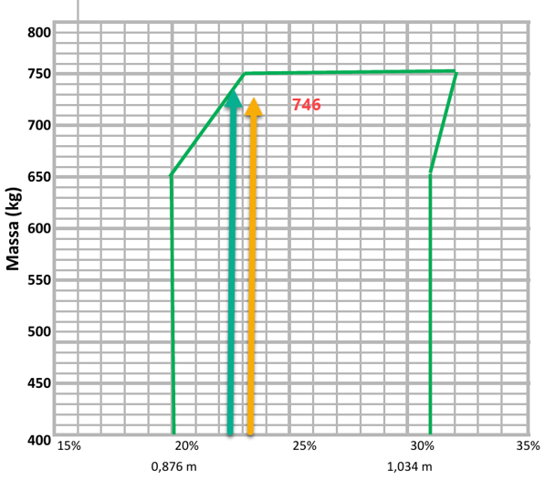

# Weight & Balance — Sonaca S2 / Sling 2

A desktop Weight & Balance calculator for the Sonaca S2 (also marketed as the Sling 2) light aircraft, built with C# and Avalonia.

## Features

- Input table matching the standard W&B Excel sheet used for the Sonaca S2
- Live centogram chart showing your CG position against the POH envelope
- Colour-coded rows: green = within limits, red/orange = outside limits
- Separate Takeoff and Landing CG calculation (accounts for fuel burn)
- All aircraft constants sourced from **Sonair-S2-D-MAN-001 Rev B** (§2.6, §2.7, §6-5)

## Screenshot



## Requirements

- [.NET 10 SDK](https://dotnet.microsoft.com/download) (or .NET 8+)
- Windows, macOS, or Linux

## Getting started

```bash
git clone https://github.com/WeightBalance/WeightBalance.git
cd WeightBalance
dotnet run
```

## How to use

| Field | Description |
|---|---|
| Empty aircraft | Basic Operating Weight from your aircraft's W&B document |
| Pilot & Passengers | Total occupant weight |
| Baggage (area 1) | Forward baggage, max 35 kg |
| Baggage (area 2) | Aft baggage, max 25 kg (area 1 + 2 combined ≤ 35 kg) |
| Fuel | Fuel uplift in kg (max 100.8 kg = 140 L × 0.72 kg/L) |
| Fuel Burn | Estimated fuel burn for the planned mission |

The chart on the right updates in real time as you type. Your **Takeoff** position is shown as a teal dot and the **Landing** position as an orange dot. A red ring indicates the point is outside the envelope.

## Aircraft data (Sonair-S2-D-MAN-001 Rev B)

### CG formula (§6-5)

```
CG position (mm) = Total Moment / Total Mass
CG % MAC = 100 × (CG_mm − 612) / 1318
```

LEMAC = 612 mm from datum; MAC = 1318 mm.

### CG envelope (§2.7)

| Condition | CG limit | % MAC |
|---|---|---|
| Forward limit ≤ 650 kg | 0.876 m | 20% |
| Forward limit at 750 kg | 0.915 m | 23% |
| Aft limit ≤ 650 kg | 1.021 m | 31% |
| Aft limit at 750 kg | 1.034 m | 32% |

### Mass limits (§2.6)

| Limit | Value |
|---|---|
| Max Take-off Weight | 750 kg (1650 lbs) |
| Max baggage area 1 | 35 kg |
| Max baggage area 2 | 25 kg |
| Max baggage area 1 + 2 combined | 35 kg |
| Fuel density | 0.72 kg/L |
| Max fuel | 2 × 70 L = 140 L (100.8 kg) |

## Disclaimer

This tool is for **planning purposes only**. Always verify your Weight & Balance against your aircraft's official W&B document and POH before flight. The pilot in command is responsible for ensuring the aircraft is loaded within approved limits.

## Tech stack

- [Avalonia](https://avaloniaui.net/) 12 — cross-platform UI framework
- .NET 10
- [CommunityToolkit.Mvvm](https://learn.microsoft.com/en-us/dotnet/communitytoolkit/mvvm/) 8.3 — MVVM source generators
